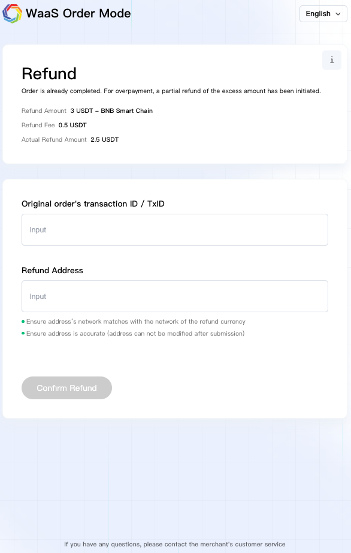

# Payer Interface

1. Cregis Built-in Payment Link\
   \
   This enables you to send the checkout\_url (received in the Create Order response) to your payers. All of the first payment, additional payment if needed, partial refund if needed, full refund if needed and the completion page are handled in a one-step flow, and the payer can be redirected back to your page after completion. For example: if the first payment is underpaid, the checkout page will be redirected to the additional payment page, if the first payment is overpaid, the checkout page will be redirected to the partial refund page and so on. 
   1. Choose the cryptocurrency on the checkout page: the payer can select one cryptocurrency to complete the payment. If the order currency differs from the payment currency, the system automatically performs the conversion using the real-time exchange rate. (Merchants can also restrict the accepted payment currencies via the tokens parameter in the API.)\
      .png>) 
   2.  Review the order details: payers can review the order details on the checkout page including the order amount, order number, product description and so on.

       <figure><figcaption></figcaption></figure>

   3. Choose the payment network: after selecting the payment currency, the payer chooses the payment network.\
      .png>) 
   4. Pay to the generated address or QR code: once the selection is complete, the system generates a payment address and a QR code. The payer can either copy the address or scan the QR code to complete the payment.\
      .png>) 
   5. Pay with a third-party wallet: payers may also choose to use a third-party wallet to scan the QR code for payment. After scanning, the third-party wallet automatically fills in the currency, network and amount, allowing the payer to confirm the payment seamlessly.\
      .png>) 
   6. Completion and redirect: after a successful payment, the page is redirected to a payment completion page. After 5 seconds, the payer will be automatically redirected back to the merchant's website (specified via the success\_url field in the API).\
      .png>) 
   7. Underpaid: if the payment is partial (order status is Additional Payment Required), the checkout page will be directed to the additional payment page. The payer can use the QR code to pay the remaining balance. Once the payment is done, it is directed to the success page as in step f.\
      .png>) 
   8. Overpaid: if the payment is overpaid (the order status is paid because the refund and order flows are processed separately), the checkout page is directed to the partial refund page, which shows the refund reason and amount. The payer can fill in the refund information. Once completed, it is directed to the success page as in step f.\
       
   9. Full-refund: if the payment is partial paid with a non-stablecoin, still partial paid after the additional payment or the additional payment not completed within valid time, the checkout page is directed to the full refund page, which shows the refund reason and amount. The payer can fill in the refund information. Once completed, it is directed to the refund completion page.\
      .png>)\
      \
      .png>) 
   10. Timeout: if the order times out (order status is expired), the checkout page is directed to the timeout page.\
       .png>) 
   11. AML hit: if the payment hits the AML rules (the order status will be cancelled), the checkout page is directed to the transaction cancelled page and the payer is notified to reach the merchant for the next step. 
2. Self-Hosted Payment Acceptance\
   \
   As an alternative, you can use your own website to host the payment page and build your own design based on your needs. 
   1.  Create the order and present the payment address: once the order is created via the Create Order request, you can either present the payment\_info payment address in text form, or convert it into a QR code to accept payment.

       <figure><figcaption></figcaption></figure>

   2.  Receive the callback and take the next action: Once payment is received, Cregis will send a callback to the callback\_url which is submitted in Create Order request. The callback includes below status which can be identified for next action:

       <figure><figcaption></figcaption></figure>

| Type                        | event\_name                | event\_type                   | Action suggested                                                                                                                                                                    |
| --------------------------- | -------------------------- | ----------------------------- | ----------------------------------------------------------------------------------------------------------------------------------------------------------------------------------- |
| Additional Payment Required | waasom\_order              | additional\_payment\_required | Requires the payer to make an additional payment. The additional payment amount can be found in the parameter additional\_amount\_required.                                         |
| Cancelled                   | waasom\_order              | cancelled                     | The order is cancelled. In the meantime, the next refund or payment exception callback will be sent to the same URL with the reasons.                                               |
| Expired                     | waasom\_order              | expired                       | The payment acceptance time has expired. No longer can accept payment. You need to create another order to continue accepting payment.                                              |
| Initiated                   | waasom\_refund             | initiated                     | The refund is initiated. You can see the reason why the order was cancelled, and refund the amount received to the payer.                                                           |
| Refund Failed               | waasom\_refund             | refund\_failed                | The refund has failed. This is a very unlikely event. To investigate the cause, the Cregis support team will contact you, or you may also reach out to our support team directly.   |
| Initiated                   | waasom\_payment\_exception | initiated                     | The payment exception is initiated. You can see the reason why the order was cancelled, and settle to your address or refund the amount received to the payer.                      |
| Transfer Failed             | waasom\_payment\_exception | transfer\_failed              | The transfer has failed. This is a very unlikely event. To investigate the cause, the Cregis support team will contact you, or you may also reach out to our support team directly. |

For other order, refund or payment exception updates, you can check the flow status through the callback status of paid, refunding or transferring. Once initiated, these statuses will automatically proceed to the next step. For the status of transferred, refund\_successful or transfer\_successful, these represent the end of the order, refund or payment exception lifecycles, so no further action is required.
