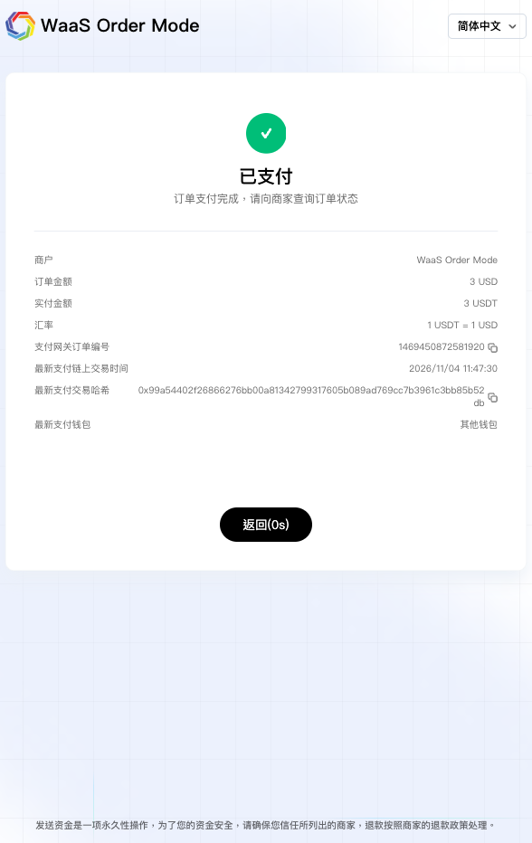
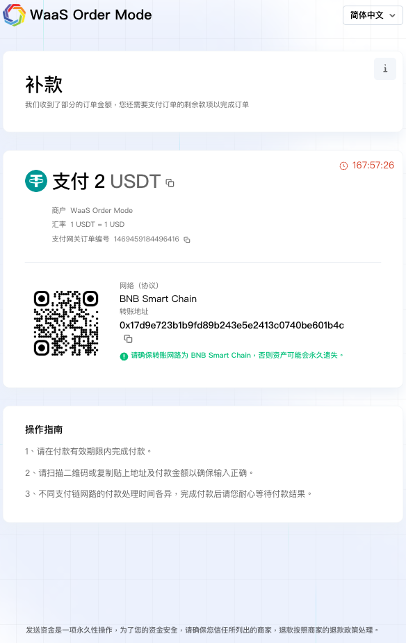
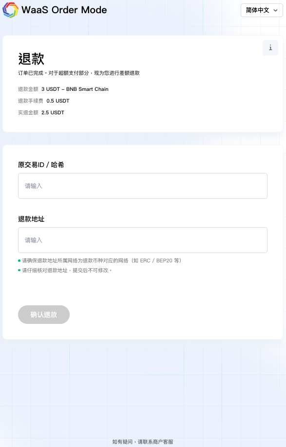
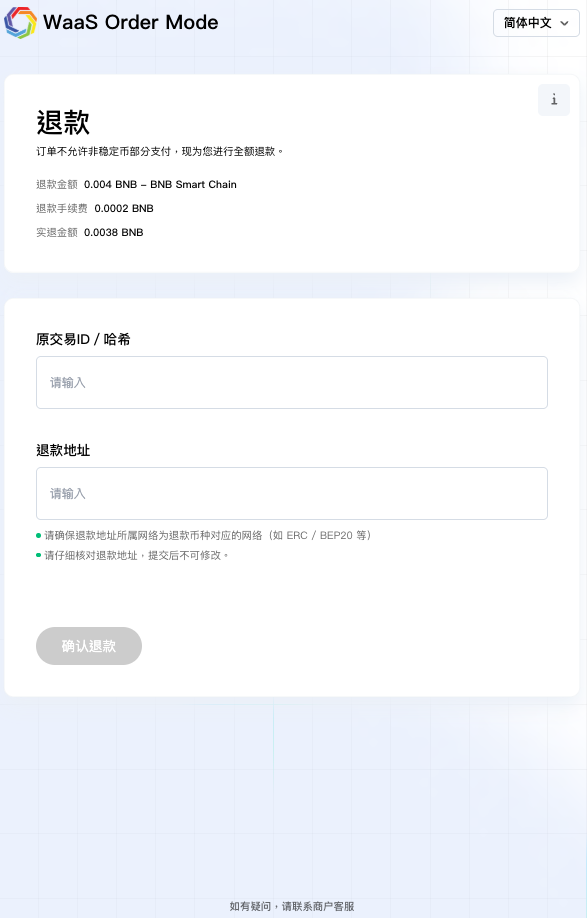
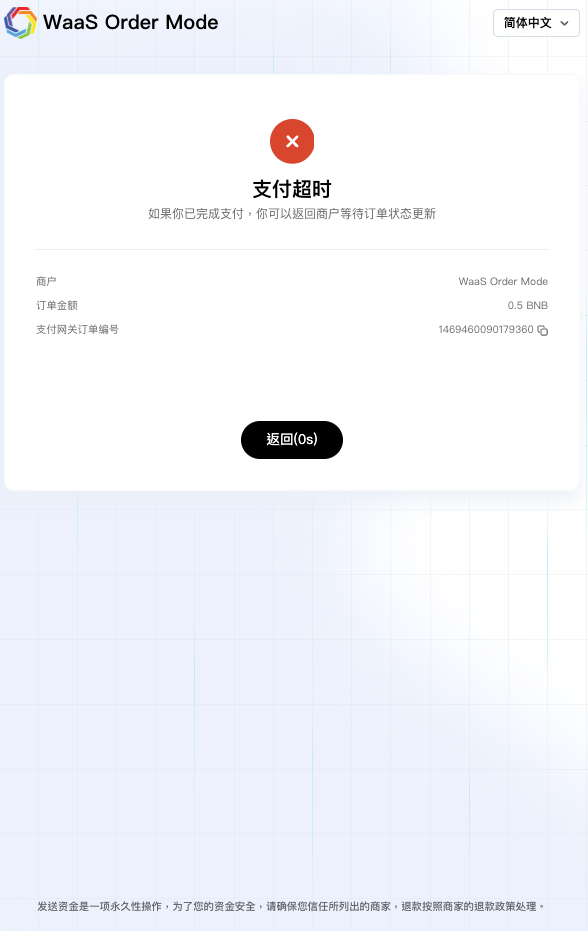

# 付款方界面

1. Cregis 内建付款链接\
   \
   此方式让您可将创建订单响应中取得的 checkout\_url 发送给付款方。对于首笔付款、需要时的补款、需要时的部分退款、需要时的全额退款及完成页面，全部皆可在一个流程中完成，完成后更可跳回至您的网站。例如：首笔付款少付时，收银台会跳转至补款页面、首笔超额付款时，收银台会跳转至部分退款页面等等。 
   1. 选择加密货币：在收银台页面上，付款方可选择一种加密货币完成付款。若订单货币与支付币种不同，系统会以即时汇率自动完成换算。 （商户亦可透过 API 中的 tokens 参数限制可接受的支付币种。）\
      .png>) 
   2.  查看订单详情：付款方可在收银台页面查看订单详情，包括订单金额、订单编号、商品描述等。

       <figure><figcaption></figcaption></figure>

   3. 选择支付网络：选定支付币种后，付款方需选择支付网络。\
      .png>) 
   4. 在已生成的地址或二维码付款：选择完成后，系统会生成一个付款地址及二维码。付款方可复制地址，或扫描二维码完成付款。\
      .png>) 
   5. 使用第三方钱包：付款方亦可使用第三方钱包扫描二维码付款。扫描后，第三方钱包会自动填入币种、网路及金额，付款方只需确认即可完成付款。\
      .png>) 
   6. 完成及跳转：付款成功后，页面会跳转至付款完成页面。 5 秒后，付款方会自动被带回商户网站（透过 API 中的 success\_url 参数）。\
       
   7. 部分支付：若付款不足（订单状态为需补款），收银台页面会跳转至补款页面。付款方可使用二维码支付剩额；完成后，会如步骤 f 跳转至成功页面。\
       
   8. 超额支付：若超额付款（订单状态仍为已支付，因为退款流程与订单流程可独立处理），收银台会跳转至部分退款页面，显示退款原因及金额。付款方可填写退款资料；完成后，会如步骤 f 跳转至成功页面。\
       
   9. 全额退款：若付款为非稳定币的部分支付、补款后仍不足，或补款超时，收银台会跳转至全额退款页面，显示退款原因及金额。付款方可填写退款资料；完成后，会跳转至退款完成页面。\
      \
      \
      .png>) 
   10. 超时：若订单超时（订单状态为已超时），收银台会跳转至超时页面。\
        
   11. 触发 AML：若付款触发 AML 规则（订单状态会变为已取消），收银台会跳转至交易取消页面，并通知付款方联络商户处理后续步骤。 
2. 自行架设收款\
   \
   另一种方式：您可以使用自己的网站托管收款页面，并按自身需求自订设计。 
   1.  创建订单并展示付款地址：透过「创建订单」请求后，您可将 payment\_info 中的付款地址以文字形式展示，或转换为 QR Code，供付款方付款。 

       <figure><figcaption></figcaption></figure>

   2.  接收回调并处理下一步：收到付款后，Cregis 会向创建订单请求中提交的 callback\_url 发送回调。回调包含以下状态，可供您判断下一步动作：

       <figure><figcaption></figcaption></figure>

| 类型   | event\_name                | event\_type                   | 建议下一步                                                |
| ---- | -------------------------- | ----------------------------- | ---------------------------------------------------- |
| 需补款  | waasom\_order              | additional\_payment\_required | 需付款方补款。补付金额可在 additional\_amount\_required 参数中找到。    |
| 已取消  | waasom\_order              | cancelled                     | 订单已取消。同时，下一退款或异常支付回调会连同原因发送至同一网址。                    |
| 已超时  | waasom\_order              | expired                       | 收款有效期已过，无法再接受付款。您需要创建另一订单以继续收款。                      |
| 已生成  | waasom\_refund             | initiated                     | 退款已发起。您可查看订单被取消的原因，并将已收到的款项退还给付款人。                   |
| 退款失败 | waasom\_refund             | refund\_failed                | 退款失败。此情况极为罕见。为调查原因，Cregis 客服团队将会与您联系，您亦可主动联系我们的客服团队。 |
| 已生成  | waasom\_payment\_exception | initiated                     | 异常支付已发起。您可查看订单被取消的原因，然后选择将款项结算至您的地址或将已收到的金额退还给付款人。   |
| 转账失败 | waasom\_payment\_exception | transfer\_failed              | 转账失败。此情况极为罕见。为调查原因，Cregis 客服团队将会与您联系，您亦可主动联系我们的客服团队。 |

对于其他订单、退款单或异常支付单的更新，您可透过 paid 、refunding 或 transferring 的回调状态来查询流程状态。这些状态一旦触发，即会自动进入下一步。而 transferred 、refund\_successful 或 transfer\_successful 等状态，则代表订单、退款单或异常支付单的生命周期已结束，因此无需再采取任何操作。
